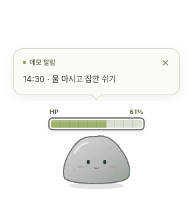
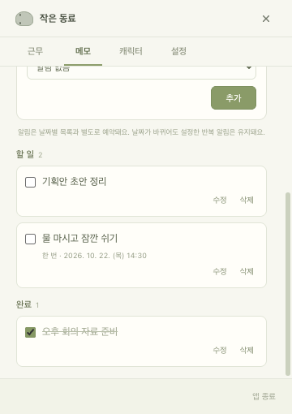
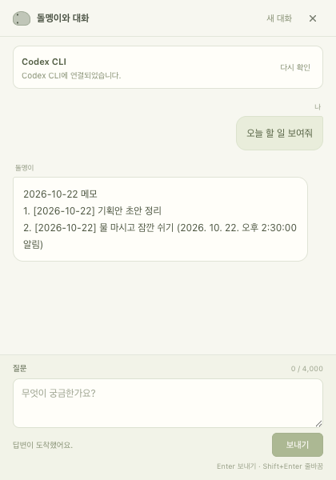

# DeskMate

**내 Agent와 함께 기능과 캐릭터를 만들어 쓰는 macOS 데스크톱 동료입니다.**

저장소를 clone하고, 자신이 사용하는 코딩 Agent에 원하는 기능·외형·동작을 요청해 나만의 앱으로 발전시키는 프로젝트입니다.
기본 캐릭터·퇴근 HP·날짜별 할 일·대화 기능은 커스터마이징을 시작할 수 있도록 준비한 출발점입니다.

## 내 Agent로 시작하기

macOS·Git·Node.js 24와 프로젝트 파일을 수정할 수 있는 Agent를 준비하세요.

```sh
git clone https://github.com/didxodnr0769-bom/deskmate.git
cd deskmate
npm ci
```

Codex·Claude Code·사용 중인 IDE Agent에서 **이 `deskmate` 폴더를 열고** 다음과 같이 요청하세요.

```text
AGENTS.md와 docs/customization.md를 읽고 현재 구조를 파악해줘.
기본 캐릭터는 유지하면서 다람쥐 캐릭터를 추가해줘.
대기·좌우 걷기·잡기·놓기·알림 동작과 클릭 영역도 함께 맞춰줘.
변경 후 관련 테스트와 빌드를 실행하고, 앱에서 확인할 항목을 알려줘.
```

변경한 앱은 `npm run dev`로 빌드·실행합니다. 이미 앱이 켜져 있다면 종료한 뒤 다시 실행하세요.

**[Agent 설치·로그인부터 프로젝트 열기, 사진 첨부와 기능 추가까지 → 커스터마이징 시작 안내](docs/customization.md)**

## 무엇을 바꿀 수 있나요?

- **캐릭터 추가** — 내 반려동물 사진이나 원하는 모습으로 새 동료 만들기
- **외형과 동작 수정** — 이동 방향, 걷기·쉬기·알림 반응을 캐릭터에 맞추기
- **기능 확장** — 메모·근무·설정에 필요한 기능을 더하거나 새로운 도구 추가하기
- **앱의 AI 연결 변경** — 내 Agent에 요청해 대화 연결 어댑터 교체하기

## 기본 구성 예시

<table>
  <tr><th>데스크톱 동료</th><th>날짜별 할 일</th><th>앱 내 대화</th></tr>
  <tr>
    <td></td>
    <td></td>
    <td></td>
  </tr>
</table>

예제 메모와 모의 연결의 데모 대화로 캡처한 실제 앱 화면입니다. 기본 기능의 조작법은 [사용 안내](docs/usage.md)를 참고하세요.

소스를 수정하는 Agent는 clone한 프로젝트에서 사용합니다. 실행된 DeskMate 안의 대화 창은 메모·근무 조회와 변경을 돕는 선택 기능입니다.
이 앱 내 대화를 쓰려면 별도로 Codex CLI를 준비하며, 자세한 내용은 [대화 연결 안내](docs/usage.md#ai-대화)에 있습니다.

## 더 알아보기

- [처음부터 내 Agent로 커스터마이징하기](docs/customization.md)
- [캐릭터 외형·동작 구현 가이드](docs/character-guide.md)
- [앱 내 대화 연결을 교체하는 가이드](docs/agent-provider-guide.md)
- [기본 사용법과 내 Mac용 앱 만들기](docs/usage.md)
- [구조](docs/architecture.md) · [검증 결과](docs/verification.md) · [보안·데이터 처리](docs/security.md)

Agent용 공통 작업 안내는 [AGENTS.md](AGENTS.md)와 [Agent 안내](.agents/README.md)에 있습니다.
현재는 소스를 직접 빌드하는 방식이며 설치용 앱 다운로드는 제공하지 않습니다.

## 라이선스

프로젝트 코드는 [MIT 라이선스](LICENSE)로 제공합니다. 이미지 출처·권리 범위는 [이미지 안내](docs/assets.md), 외부 구성요소는 [타사 소프트웨어 고지](THIRD_PARTY_NOTICES.md)를 확인하세요.
