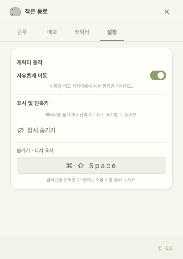

# DeskMate 사용 안내

화면 조작, 날짜별 메모와 알림, 선택적인 AI 연결, 로컬 데이터와 빌드 방법을 안내합니다.
구현 책임과 저장 계약은 [구조 안내](architecture.md), 수행한 점검은 [검증 안내](verification.md)를 참고하세요.

## 실행과 기본 조작

개발 환경은 macOS와 Node.js 22.12.0 이상이며, 프로젝트의 `.nvmrc`는 Node.js 24를 지정합니다.
[README의 시작하기](../README.md#시작하기)에 따라 의존성을 설치하고 `npm run dev`로 실행하세요.
이 명령은 한 번 빌드한 뒤 Electron을 실행하므로 소스를 수정했다면 앱을 종료하고 다시 실행합니다.

`npm ci`는 Electron 실행 파일도 내려받습니다. 다운로드가 중단되었다면 `npx --no-install install-electron`으로 다시 받을 수 있습니다.

| 조작 | 동작 |
| --- | --- |
| 캐릭터 좌클릭 | 대화 창 열기 |
| 우클릭·Control+클릭·트랙패드 보조 클릭 | 화면 선택 메뉴 열기 |
| 캐릭터 드래그 | 놓은 위치와 높이에서 이동 이어가기 |
| `⌘⇧Enter` | 대화 창 열기 |
| `⌘⇧Space` | 캐릭터와 패널 숨기기·다시 표시 |
| 메뉴 막대의 아이콘 | 대화·패널·설정·표시·종료 |

Dock 아이콘은 표시하지 않습니다. 캐릭터 외의 투명 영역은 뒤의 창을 클릭할 수 있게 처리합니다.
관리 패널에는 다음 네 화면이 있습니다.

| 화면 | 기능 |
| --- | --- |
| 근무 | 출근일·출근시간·퇴근시간과 HP |
| 메모 | 날짜별 할 일과 알림 예약 |
| 캐릭터 | 캐릭터 종류·크기 |
| 설정 | 자유 이동, 잠시 숨기기, 숨기기·다시 표시 단축키 |

## 근무시간과 HP

우클릭 → **근무시간**에서 출근일과 시각을 입력한 뒤 **적용**을 누르세요.
출근시간을 바꾸면 퇴근시간을 기본 +9시간으로 채우며, 이후 직접 고칠 수 있습니다.

HP는 출근 전과 출근 시각에 0%, 퇴근 시각부터 100%입니다.
근무 중에는 진행률을 내림하고 남은 분은 올림하며 약 1초마다 갱신합니다.
표시 색상은 0~20% 빨강, 21~40% 주황, 41~60% 노랑, 61~80% 초록, 81~100% 진한 초록입니다.

퇴근시간이 출근시간보다 이르면 다음날 퇴근으로 계산합니다. 같은 시각은 입력할 수 없습니다.
저장한 출근일은 자정이나 재실행 때 자동으로 바뀌지 않으므로 다른 날의 근무는 날짜를 바꾸어 적용하세요.

## 날짜별 메모

우클릭 → **메모**를 열면 기본으로 오늘의 할 일을 보여줍니다.
달력과 이전·다음 날짜 버튼으로 기록을 확인하고, 선택한 날짜에 새 메모를 추가할 수 있습니다.

오늘 목록을 보는 동안 자정이 지나면 새 날짜로 전환됩니다. 어제 할 일은 오늘 목록에서 빠지지만 삭제되지 않습니다.
이전에 작성한 항목은 그 날짜에서 확인할 수 있으며, 명시적으로 선택한 다른 날짜는 시각 갱신만으로 바뀌지 않습니다.

본문을 입력하고 **추가**, 기존 항목은 **수정** → **저장**을 누르세요.
체크박스로 완료·완료 취소를 하고, **삭제**는 확인 후 처리합니다.
완료한 항목도 보관하며 본문은 앞뒤 공백을 제외한 1~1,000자, 완료 항목을 포함해 날짜당 최대 500개입니다.

### 알림 방식

| 방식 | 동작 |
| --- | --- |
| 알림 없음 | 예약하지 않음 |
| 시각 한 번 | 다음에 도래하는 로컬 `HH:mm`에 한 번 |
| 몇 분 뒤 | 저장한 순간부터 지정한 분 뒤에 한 번 |
| 매일 | 매일 선택한 로컬 시각 |
| 요일 반복 | 선택한 요일의 로컬 시각 |

할 일의 관리 날짜와 알림 예약은 별개입니다. 날짜를 바꾸어도 예약을 자동 취소하지 않습니다.
시각 한 번은 현재 분이면 즉시, 이미 지난 시각이면 다음날 알립니다.
몇 분 뒤로 저장한 항목은 수정 화면에 예약 일시를 보여주며 **다시 예약**을 선택해야 새로 계산합니다.

본문만 수정하면 기존 예약과 확인 상태를 유지합니다. 알림 방식·시각·요일을 바꾸면 재예약합니다.
완료·삭제·알림 **해제**는 예약을 취소하고, 완료 취소는 설정한 일정으로 다시 활성화합니다.

### 알림 확인과 복원

알림은 소리 없이 캐릭터 말풍선에 표시되며 직접 닫을 때까지 유지됩니다.
말풍선을 누르면 해당 메모의 날짜를 엽니다. 이 동작과 X로 닫기는 메모 완료와 별개입니다.

여러 알림은 예약 시각 순서로 하나씩 표시합니다.
숨긴 캐릭터는 알림 때 잠시 나타나고 모두 닫으면 다시 숨겨집니다. 관리 패널을 직접 열었다면 표시를 유지합니다.

앱 실행 중에는 약 1초 간격으로 확인하고 잠자기 복귀·재실행 때 미확인 예약을 복구합니다.
앱이 종료된 동안에는 알릴 수 없습니다. 일회성 알림은 확인 후 다시 표시하지 않습니다.
반복 알림은 닫을 때 현재보다 뒤의 다음 회차를 예약하며, 놓친 과거 회차를 연달아 표시하지 않습니다.
확인을 저장하지 못하면 말풍선과 오류 안내를 유지하므로 다시 닫아 주세요.

## 캐릭터와 표시 설정

**캐릭터** 탭에서 돌멩이·검은 고양이·크림 토끼·첼시·츄츄와 크기 75·100·125·150%를 선택합니다.
캐릭터와 HP가 함께 바뀌고 말풍선 글자 크기는 유지합니다. 종류와 크기는 재실행 후에도 유지됩니다.

첼시와 츄츄는 좌우 측면 보행, 몸돌리기, 그루밍, 기지개와 졸기 동작을 보여줍니다.
대화·패널·메뉴·알림·드래그가 이동보다 우선하며 드롭한 위치와 높이를 유지합니다.

**설정** 탭에서 자유 이동을 켜거나 끄고 캐릭터를 잠시 숨길 수 있습니다.
이동을 꺼도 제자리 휴식 동작은 이어집니다. 숨긴 뒤에는 단축키나 메뉴 막대에서 다시 표시하세요.
숨기기 단축키 입력칸을 선택하고 새 조합을 누르면 변경합니다. 다른 앱이나 대화 단축키와 충돌하면 기존 등록을 유지합니다.
위치·이동·숨기기 단축키는 현재 앱 실행 중에만 적용됩니다. 대화 창에는 단축키 변경 UI가 없습니다.



## AI 대화

메모·근무시간·캐릭터는 AI 연결 없이도 동작합니다. AI 대화에는 별도의 Codex CLI 설치와 로그인이 필요합니다.

1. [공식 안내](https://developers.openai.com/codex/cli)에 따라 Codex CLI를 설치하세요. 현재 어댑터는 `0.154.0` 이상을 요구합니다.
2. 터미널에서 `codex login`으로 로그인하세요.
3. 캐릭터 클릭, `⌘⇧Enter`, 우클릭 또는 메뉴 막대의 **대화하기**로 창을 엽니다.
4. 질문을 입력하고 **Enter** 또는 **보내기**로 전송합니다. **Shift+Enter**는 줄바꿈입니다.

연결에 문제가 있으면 화면 안내를 확인하고 **다시 확인**을 누르세요.
대화 열기 단축키는 `⌘⇧Enter`이며 대화 창에서 변경하지 않습니다.
CLI를 자동으로 찾지 못하면 앱 실행 환경에 `DESKMATE_CODEX_PATH`로 실행 파일의 절대경로를 지정할 수 있습니다.
개인 경로나 인증 파일은 저장소에 넣지 마세요.

### 대화 기록과 취소

질문은 최대 4,000자입니다. **새 대화** 전까지 실제 질문·답변을 함께 전달하며 이력에서 확인할 수 있습니다.
창을 닫거나 **Esc**를 눌러도 이력·입력 초안·진행 요청은 유지됩니다.
**새 대화**는 진행 요청을 취소하고 이력과 맥락을 초기화합니다. 대화는 앱 실행 중 메모리에만 보관하며 종료하면 사라집니다.

질문을 보내면 캐릭터 말풍선에 **응답 생성 중…**이 표시됩니다.
X는 표시만 접고 **취소**는 요청을 종료합니다. 늦은 답변은 취소·새 대화 이후 표시하지 않습니다.
응답 제한 시간은 120초이며 시간 초과도 요청을 종료합니다. 실제 메모 알림이 AI 말풍선보다 먼저 표시됩니다.

### 대화로 앱 조작

- “메모 목록 보여줘”, “어제 메모 보여줘”
- “10분 뒤에 물 마시라고 알려줘”, “매일 오후 3시에 스트레칭 알려줘”
- “회의 준비 메모 완료해줘”, “그 메모 완료 취소해줘”
- “퇴근시간을 오후 7시로 바꿔줘”, “자유 이동 멈춰줘”

메모 조회·추가·수정·완료는 날짜 생략 시 오늘만 대상으로 합니다. 다른 날짜는 명시해서 요청하세요.
변경 대상이 여러 개면 후보 번호를 묻습니다. “3시”처럼 모호한 시간도 먼저 확인합니다.
삭제는 메모 관리 화면에서 확인 후 처리합니다. 실제 데이터 조회·저장은 앱의 서비스가 검증하고 실행합니다.

### AI에 전달하는 데이터

일반 대화에 메모·근무시간 파일 전체를 자동으로 제공하지 않습니다.
다만 사용자가 요청한 조회·요약·변경 결과는 보이는 답변 이력에 남으며 다음 질문에도 함께 전달됩니다.
조회 결과를 다음 대화에 남기지 않으려면 **새 대화**를 시작하세요.

앱은 기존 CLI 로그인을 사용하며 API 키나 인증 파일을 따로 복사·저장하지 않습니다.
CLI 인증 캐시와 자체 운영 기록은 CLI가 관리합니다. 실시간 검색과 임의의 로컬 파일 작업은 제공하지 않습니다.
실행 권한과 다른 연결로 교체하는 방법은 [AI 연결 안내](agent-provider-guide.md)에 있습니다.

## 로컬 데이터와 이전 버전

데이터는 Electron의 `userData` 폴더에 저장됩니다.

| 파일 | 내용 |
| --- | --- |
| `memos.json` | 날짜별 메모·완료 상태·예약·알림 확인 |
| `worktime.json` | 적용한 근무 날짜와 출퇴근시간 |
| `appearance.json` | 캐릭터 종류와 크기 |
| `memos.v<이전 버전>.backup.json` | 메모 형식 변경 전 원본 |

현재 메모 저장 형식은 v5입니다. v1~v4 항목은 생성 시각의 로컬 날짜로 분류합니다.
첫 알림 초기화 또는 변경 때 원본을 백업한 뒤 교체하며 기존 백업은 덮어쓰지 않습니다.
v3/v4의 예약·확인 상태와 본문·완료·생성 및 수정 시각은 유지합니다.
백업·저장 실패나 손상된 파일은 원본을 유지하고 오류를 표시합니다.

이전 `briefing.json`이 남아 있어도 읽거나 실행하지 않습니다.
검증용 `COMPANION_DATA_DIR`는 소스 폴더 밖의 별도 폴더를 지정하세요.
메모·개인 설정·대화 기록·인증 정보는 공유 소스에 포함하지 마세요.

## 앱 만들기와 개발 명령

```sh
npm run package:mac
```

생성 경로는 `release/Desktop Companion-darwin-<아키텍처>/Desktop Companion.app`입니다.
만드는 Mac의 CPU 아키텍처를 따르며, 패키징한 앱을 실행할 때는 Node.js가 필요하지 않습니다.
프로젝트명은 DeskMate이고 기존 데이터 호환성을 위해 macOS 앱 이름은 `Desktop Companion.app`을 유지합니다.
소스 ZIP은 `release/deskmate-v<버전>-source.zip`이며 최상위 폴더는 `deskmate/`입니다.

| 명령 | 동작 |
| --- | --- |
| `npm run dev` | 타입 검사·빌드 후 Electron 실행 |
| `npm run build` | 타입 검사 후 `dist/` 생성 |
| `npm run typecheck` | TypeScript 타입 검사 |
| `npm test` | 자동 테스트 실행 |
| `npm start` | 기존 빌드로 Electron 실행 |
| `npm run package:mac` | macOS 앱과 앱·소스 ZIP 생성 |

현재 공개 범위는 소스 코드입니다. 앱 다운로드 배포·Apple 개발자 서명·공증·DMG는 제공하지 않습니다.
기술 구성과 정확한 의존성 버전은 `package.json`·`package-lock.json`을 기준으로 합니다.

## 소스 커스터마이징과 라이선스

프로젝트 폴더에서 AI Agent에 [캐릭터 가이드](character-guide.md)를 읽고 외형·상태별 동작을 함께 수정하도록 요청할 수 있습니다.
기본 캐릭터 실행에 앱 내부 이미지 생성 서비스나 AI API 키는 필요하지 않습니다.
다른 AI 연결은 [Provider 교체 안내](agent-provider-guide.md)를 따르세요.

프로젝트 코드는 [MIT 라이선스](../LICENSE)를 따릅니다. 캐릭터 이미지의 제작 정보와 적용 범위는 [이미지 안내](assets.md)를 참고하세요.
외부 구성요소에는 각자의 라이선스가 적용되며 패키징 시 [타사 고지](../THIRD_PARTY_NOTICES.md)와 원본 고지를 동봉합니다.
실제 수행한 검증과 남은 수동 점검은 [검증 안내](verification.md)에서 확인하세요.
